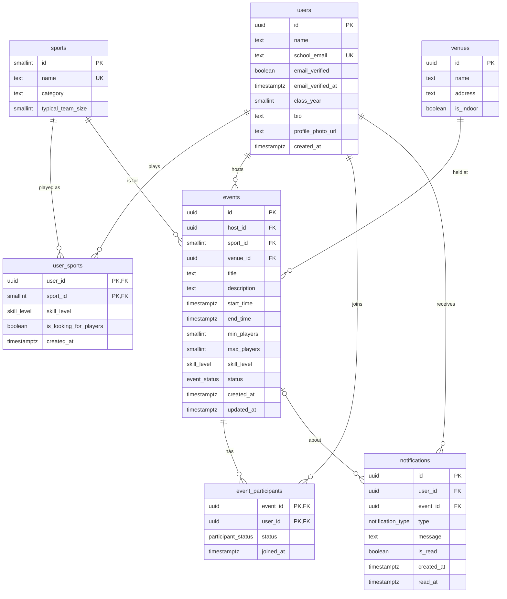

# Database Design: Campus Pickup Sports & Events

Relational schema (PostgreSQL) derived from the domain model. It covers seven tables: `users`, `sports`, `user_sports`, `venues`, `events`, `event_participants`, and `notifications`.

## 1. ERD



## 2. Enum types

```sql
CREATE TYPE skill_level         AS ENUM ('beginner', 'intermediate', 'advanced');
CREATE TYPE event_status        AS ENUM ('open', 'full', 'cancelled');
CREATE TYPE participant_status  AS ENUM ('going', 'cancelled');
CREATE TYPE notification_type   AS ENUM (
  'event_joined', 'event_left', 'event_full',
  'event_cancelled', 'event_updated', 'event_reminder'
);
```

## 3. Tables

### users

| Column | Type | Constraints |
|---|---|---|
| id | uuid | **PK**, default `gen_random_uuid()` |
| name | text | NOT NULL |
| school_email | text | NOT NULL, UNIQUE (stored lowercase) |
| email_verified | boolean | NOT NULL, default `false` |
| email_verified_at | timestamptz | NULL until verified |
| class_year | smallint | NULL |
| bio | text | NULL |
| profile_photo_url | text | NULL |
| created_at | timestamptz | NOT NULL, default `now()` |

```sql
CREATE TABLE users (
  id                uuid PRIMARY KEY DEFAULT gen_random_uuid(),
  name              text        NOT NULL,
  school_email      text        NOT NULL UNIQUE CHECK (school_email = lower(school_email)),
  email_verified    boolean     NOT NULL DEFAULT false,
  email_verified_at timestamptz,
  class_year        smallint,
  bio               text,
  profile_photo_url text,
  created_at        timestamptz NOT NULL DEFAULT now(),
  CHECK (email_verified = (email_verified_at IS NOT NULL))
);
```

### sports

| Column | Type | Constraints |
|---|---|---|
| id | smallint | **PK**, identity |
| name | text | NOT NULL, UNIQUE |
| category | text | NULL (e.g. team, racquet, individual) |
| typical_team_size | smallint | NULL, `> 0` |

```sql
CREATE TABLE sports (
  id                smallint GENERATED ALWAYS AS IDENTITY PRIMARY KEY,
  name              text NOT NULL UNIQUE,
  category          text,
  typical_team_size smallint CHECK (typical_team_size > 0)
);
```

### user_sports

One row per sport a user plays.

| Column | Type | Constraints |
|---|---|---|
| user_id | uuid | **PK (part)**, **FK → users(id)** ON DELETE CASCADE |
| sport_id | smallint | **PK (part)**, **FK → sports(id)** ON DELETE RESTRICT |
| skill_level | skill_level | NOT NULL |
| is_looking_for_players | boolean | NOT NULL, default `false` |
| created_at | timestamptz | NOT NULL, default `now()` |

```sql
CREATE TABLE user_sports (
  user_id                uuid        NOT NULL REFERENCES users(id)  ON DELETE CASCADE,
  sport_id               smallint    NOT NULL REFERENCES sports(id) ON DELETE RESTRICT,
  skill_level            skill_level NOT NULL,
  is_looking_for_players boolean     NOT NULL DEFAULT false,
  created_at             timestamptz NOT NULL DEFAULT now(),
  PRIMARY KEY (user_id, sport_id)
);
CREATE INDEX idx_user_sports_sport ON user_sports (sport_id, skill_level);
```

### venues

| Column | Type | Constraints |
|---|---|---|
| id | uuid | **PK**, default `gen_random_uuid()` |
| name | text | NOT NULL |
| address | text | NULL |
| is_indoor | boolean | NOT NULL, default `false` |

```sql
CREATE TABLE venues (
  id        uuid PRIMARY KEY DEFAULT gen_random_uuid(),
  name      text    NOT NULL,
  address   text,
  is_indoor boolean NOT NULL DEFAULT false
);
``` 

### events

| Column | Type | Constraints |
|---|---|---|
| id | uuid | **PK**, default `gen_random_uuid()` |
| host_id | uuid | NOT NULL, **FK → users(id)** ON DELETE RESTRICT |
| sport_id | smallint | NOT NULL, **FK → sports(id)** |
| venue_id | uuid | NOT NULL, **FK → venues(id)** |
| title | text | NOT NULL |
| description | text | NULL |
| start_time | timestamptz | NOT NULL |
| end_time | timestamptz | NULL, must be after start_time |
| min_players | smallint | NOT NULL, `>= 1` |
| max_players | smallint | NOT NULL, `>= min_players` |
| skill_level | skill_level | NULL (NULL = all levels welcome) |
| status | event_status | NOT NULL, default `'open'` |
| created_at | timestamptz | NOT NULL, default `now()` |
| updated_at | timestamptz | NOT NULL, default `now()` |

```sql
CREATE TABLE events (
  id          uuid         PRIMARY KEY DEFAULT gen_random_uuid(),
  host_id     uuid         NOT NULL REFERENCES users(id)  ON DELETE RESTRICT,
  sport_id    smallint     NOT NULL REFERENCES sports(id) ON DELETE RESTRICT,
  venue_id    uuid         NOT NULL REFERENCES venues(id) ON DELETE RESTRICT,
  title       text         NOT NULL,
  description text,
  start_time  timestamptz  NOT NULL,
  end_time    timestamptz,
  min_players smallint     NOT NULL CHECK (min_players >= 1),
  max_players smallint     NOT NULL,
  skill_level skill_level,
  status      event_status NOT NULL DEFAULT 'open',
  created_at  timestamptz  NOT NULL DEFAULT now(),
  updated_at  timestamptz  NOT NULL DEFAULT now(),
  CHECK (max_players >= min_players),
  CHECK (end_time IS NULL OR end_time > start_time)
);
CREATE INDEX idx_events_feed  ON events (status, start_time);
CREATE INDEX idx_events_sport ON events (sport_id, start_time);
CREATE INDEX idx_events_host  ON events (host_id);
CREATE INDEX idx_events_venue ON events (venue_id);
```

### event_participants

| Column | Type | Constraints |
|---|---|---|
| event_id | uuid | **PK (part)**, **FK → events(id)** ON DELETE CASCADE |
| user_id | uuid | **PK (part)**, **FK → users(id)** ON DELETE CASCADE |
| status | participant_status | NOT NULL, default `'going'` |
| joined_at | timestamptz | NOT NULL, default `now()` |

```sql
CREATE TABLE event_participants (
  event_id  uuid               NOT NULL REFERENCES events(id) ON DELETE CASCADE,
  user_id   uuid               NOT NULL REFERENCES users(id)  ON DELETE CASCADE,
  status    participant_status NOT NULL DEFAULT 'going',
  joined_at timestamptz        NOT NULL DEFAULT now(),
  PRIMARY KEY (event_id, user_id)
);
CREATE INDEX idx_event_participants_user ON event_participants (user_id, status);
```

### notifications

| Column | Type | Constraints |
|---|---|---|
| id | uuid | **PK**, default `gen_random_uuid()` |
| user_id | uuid | NOT NULL, **FK → users(id)** ON DELETE CASCADE (recipient) |
| event_id | uuid | NULL, **FK → events(id)** ON DELETE CASCADE |
| type | notification_type | NOT NULL |
| message | text | NOT NULL |
| is_read | boolean | NOT NULL, default `false` |
| created_at | timestamptz | NOT NULL, default `now()` |
| read_at | timestamptz | NULL |

```sql
CREATE TABLE notifications (
  id         uuid              PRIMARY KEY DEFAULT gen_random_uuid(),
  user_id    uuid              NOT NULL REFERENCES users(id)  ON DELETE CASCADE,
  event_id   uuid              REFERENCES events(id)          ON DELETE CASCADE,
  type       notification_type NOT NULL,
  message    text              NOT NULL,
  is_read    boolean           NOT NULL DEFAULT false,
  created_at timestamptz       NOT NULL DEFAULT now(),
  read_at    timestamptz
);
CREATE INDEX idx_notifications_inbox ON notifications (user_id, is_read, created_at DESC);
```

## 4. Relationships

| Relationship | Cardinality | Notes |
|---|---|---|
| users → user_sports | 1 : N | A user lists each sport they play. Deleting a user removes their rows. |
| sports → user_sports | 1 : N | `user_sports` is the junction table for the many-to-many between users and sports. Sports in use cannot be deleted (RESTRICT). |
| users → events (host) | 1 : N | Each event has exactly one host. Hosts can't be hard-deleted while they own events; deactivate or reassign instead. |
| sports → events | 1 : N | Every event is for one sport. |
| venues → events | 1 : N | Every event happens at one venue. Venues are reusable across events. |
| events ↔ users (via event_participants) | M : N | Junction table. The composite PK stops a user from joining the same event twice. |
| users → notifications | 1 : N | The recipient. |
| events → notifications | 1 : N, optional | Most notifications are about an event, but `event_id` is nullable for future non-event notices. |

## 5. Design choices

**Skill level lives on `user_sports`, not `users`.** Skill is a property of a person *and* a sport. Someone can be advanced at tennis and a beginner at soccer. A single `users.skill_level` would be wrong for one of them. It also lets matching work properly: "find intermediate basketball players" is one indexed query on `user_sports`. The same applies to `is_looking_for_players`, which came from the domain model's `SportsInterest` entity.

**`events.skill_level` is nullable.** NULL means all levels are welcome, which avoids an extra `'any'` enum value that would have to be special-cased in comparisons. The same `skill_level` enum is shared with `user_sports`, so values can't drift apart.

**Roster and `isJoinedByMe` are not stored.** The domain model's `Event` had `roster: string[]`, `host: string`, and `isJoinedByMe`. These are replaced by `event_participants` (the roster), `host_id` (a real FK), and a per-viewer check (`EXISTS` on `event_participants`) at query time. Arrays of names would break referential integrity, and `isJoinedByMe` can't be a column because it depends on who is asking.

**Participant count is derived, and `full` is enforced transactionally.** Headcount is `COUNT(*)` of `event_participants` where `status = 'going'`, so there is no counter that can drift. When someone joins, lock the event row (`SELECT … FOR UPDATE`), check the count against `max_players`, insert, and set `status = 'full'` when the count reaches max. When someone leaves, flip it back to `open`. Cancelled events are never flipped back. The host should be inserted as a participant on creation. `min_players` is advisory (used for "needs 2 more players" displays and reminders), not a hard constraint.

**`participant_status` keeps leave history.** Setting `status = 'cancelled'` instead of deleting the row preserves the audit trail and supports "who dropped out" notifications. If you don't need that, drop the column and delete rows instead. Rejoining is an `UPDATE`, not a second insert, thanks to the composite PK.

**Verified school email.** `school_email` is unique and stored lowercase. `email_verified` is the flag you asked for, and `email_verified_at` records when. A CHECK keeps the two consistent. Enforce the school domain (e.g. `@calvin.edu`) in application code, or with a CHECK if you only support one school. Gate event creation and joining on `email_verified = true` at the application layer.

**Surrogate keys.** UUIDs for user-facing entities avoid guessable URLs. `sports` uses a small integer because it is a tiny lookup table referenced often. Junction tables use composite PKs rather than a separate id, since the pair is the natural identity.

**Enums versus lookup tables.** `skill_level`, `event_status`, and the notification type are small, stable sets, so Postgres enums are simple and self-documenting. `sports` is a table because it is expected to grow, and non-developers may need to add sports.

**Delete behavior.** Participation and notification rows cascade when the user or event is deleted. `sports`, `venues`, and event hosts use RESTRICT so core reference data is never silently removed.

**Indexes** follow the main queries: the event feed (`status, start_time`), events by sport, a user's joined events, and a user's unread notifications.

## 6. Domain model entities not included

The domain model also had `Campus`, `Connection` (friend requests), `Report`, and a `SocialEvent`/`SportsGame` split. These are outside the seven requested tables, but they fit in cleanly later:

- **campuses**: add a table and a `campus_id` FK on `users` and `venues` (the model had Campus 1 : N Student and Campus 1 : N Location).
- **connections**: `requester_id`, `addressee_id` (both FK → users), `status`, `created_at`, with a unique pair constraint.
- **reports**: `reporter_id` FK → users, plus a nullable `target_user_id` and nullable `target_event_id` (with a CHECK that exactly one is set), `reason`, `description`, `status`, `created_at`.
- **Social events**: the model's `SocialEvent` subtype could be handled by making `events.sport_id` nullable and adding a `category` column, or by a separate subtype table. The current schema assumes every event is a sports event, as in your spec.
